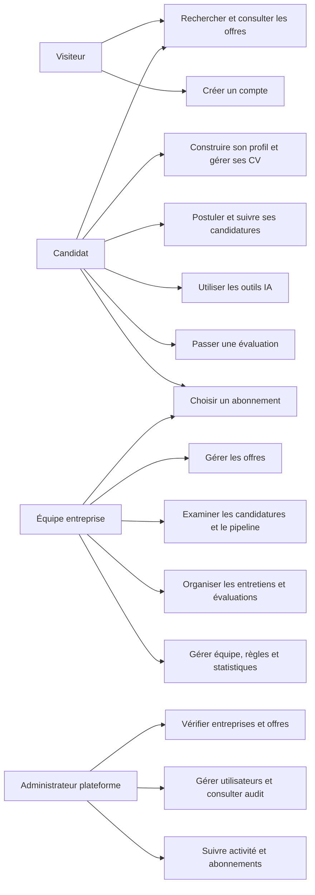
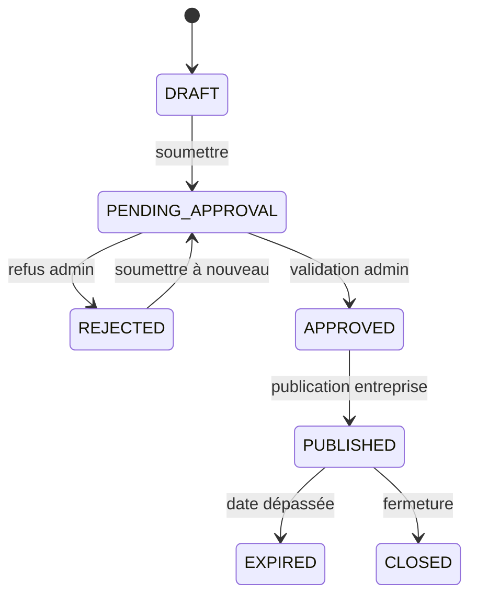
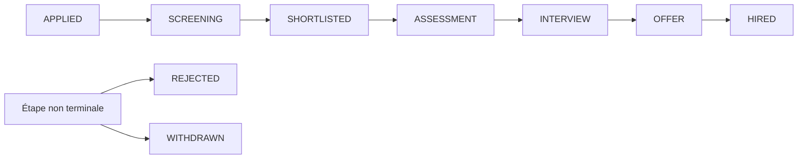
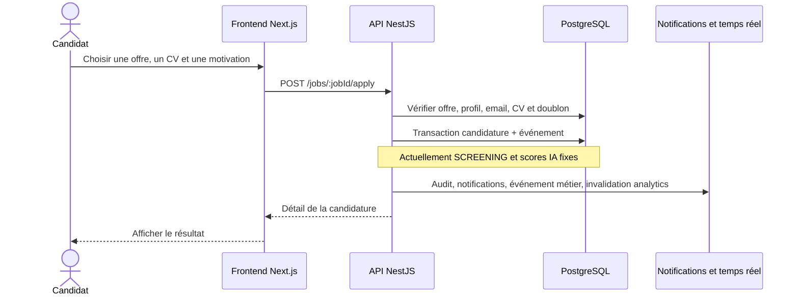
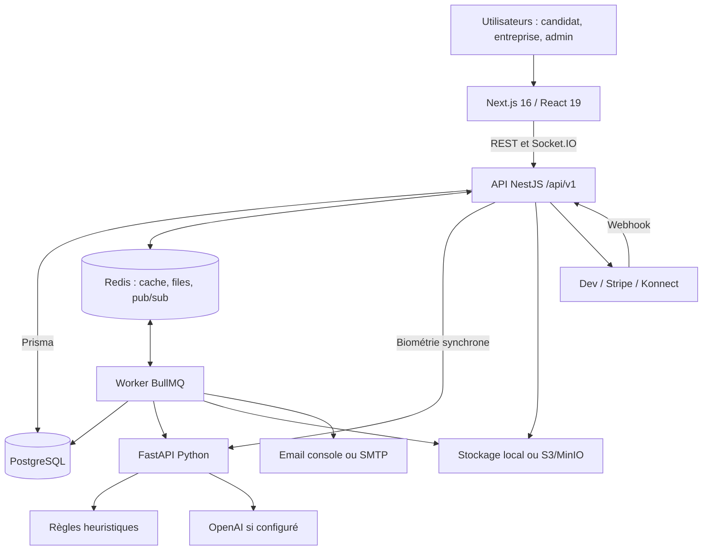
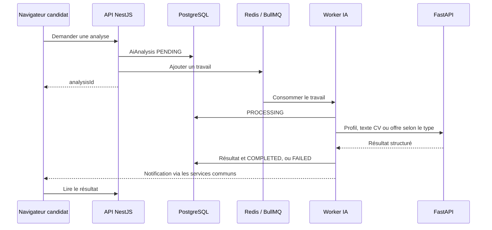
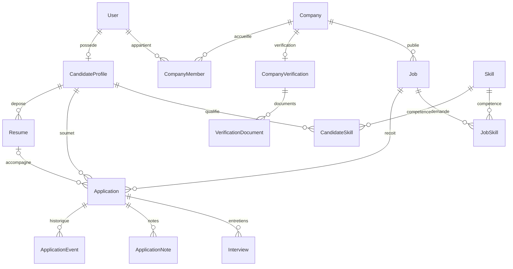
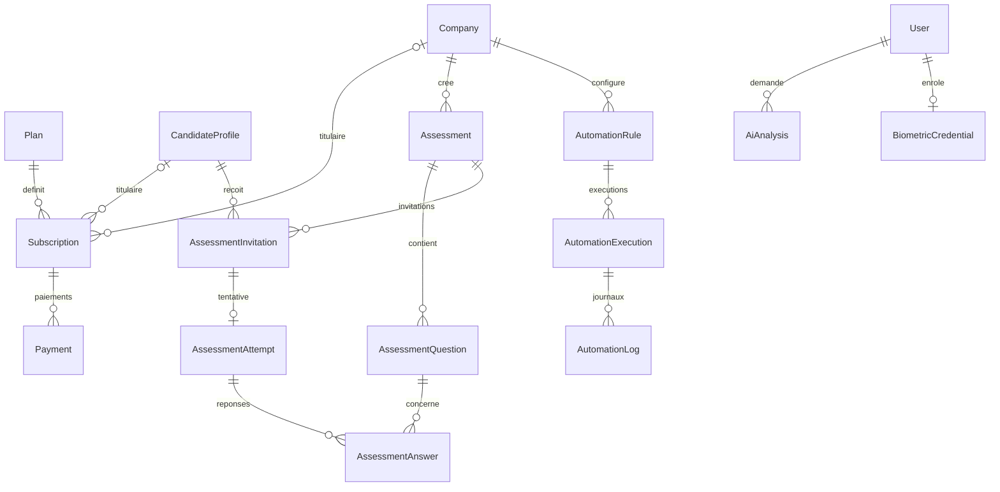

# EasyJob — Analyse globale et conception

Analyse du code local au 9 septembre 2026. Le produit est nommé **EasyJob** dans le frontend ; les documents et packages utilisent encore **Startup Starter**.

## 1. Ce que le projet construit

EasyJob est une plateforme SaaS de recrutement : les candidats trouvent des offres et postulent ; les entreprises gèrent leurs recrutements ; l'administration vérifie les entreprises et modère les offres. Elle associe un portail d'emploi, un ATS (suivi des candidatures), des outils IA, des évaluations et des abonnements.

Le code comporte **56 pages Next.js**, **128 routes HTTP NestJS déclarées** et **43 modèles Prisma**, tables de liaison comprises. Ces volumes décrivent le code présent, pas le nombre de fonctionnalités validées en production. Voir l'[inventaire technique complet](<C:/Users/Yassine/job startup/docs/INVENTAIRE_TECHNIQUE.md>).

**État constaté : socle applicatif conséquent, avec plusieurs parcours réels et plusieurs éléments de démonstration mélangés aux données métier.** L'ensemble ne peut pas être considéré comme prêt pour la production sur la seule base des README ou des tests unitaires.

## 2. Acteurs et droits

| Acteur | Responsabilités et accès prévus dans le code |
|---|---|
| Visiteur | Accueil, recherche et détail d'offres publiées, tarifs, informations et inscription. |
| CANDIDATE | Profil personnel, compétences, expériences, formations, CV, favoris, candidatures, outils IA, évaluations reçues, abonnement personnel. |
| COMPANY_ADMIN | Gestion de l'entreprise, offres, candidatures, entretiens, équipe, facturation, automatisations, évaluations et statistiques. |
| HR | Offres, candidatures, entretiens, consultation et invitation d'équipe, statistiques. |
| RECRUITER | Offres, candidatures, entretiens, consultation d'équipe et statistiques. |
| HIRING_MANAGER | Consultation et progression des candidatures, CV, entretiens, équipe et statistiques. |
| INTERVIEWER | Consultation des candidatures/CV et création/modification d'entretiens. |
| PLATFORM_ADMIN | Gestion des utilisateurs, contrôle des entreprises et offres, abonnements, statistiques globales et audit. |

Un utilisateur peut appartenir à plusieurs entreprises via `CompanyMember` et avoir un rôle différent dans chacune. Le catalogue des droits existe dans `src/common/constants/roles.ts` et `permissions.ts`. Les droits propres au candidat reposent aussi sur la propriété des ressources, même si son tableau de permissions génériques est vide.

## 3. Catalogue fonctionnel

« Présent » signifie qu'un parcours ou une logique correspondante existe dans le code. Cela ne signifie pas que tous ses cas limites ont été validés en conditions réelles.

### 3.1 Portail public

| Fonction | Contenu et état |
|---|---|
| Page d'accueil | Présentation d'EasyJob, recherche et accès aux parcours candidat/entreprise. |
| Recherche d'emploi | Mot-clé, localisation, télétravail, contrat, expérience, salaire ; API avec compétences et entreprise, pagination et tris. |
| Recherche par pertinence | Recherche plein texte PostgreSQL, avec limites de filtrage et d'ordre décrites plus bas. |
| Détail d'offre | Description, exigences, responsabilités, compétences, rémunération, type de contrat et entreprise. |
| Tarifs | Plans candidat et entreprise ; choix et redirection vers le paiement. |
| Pages d'information | À propos, contact, confidentialité et conditions. La page contact affiche des adresses ; aucun système de tickets n'a été trouvé. |
| Présentation adaptable | Navigation mobile, thèmes clair/sombre, langues anglais/français/arabe, direction RTL en arabe. Certaines pages contiennent encore des textes anglais directement dans le code. |

### 3.2 Comptes et authentification

| Fonction | Contenu et état |
|---|---|
| Inscription | Choix candidat/entreprise, formulaire avec validation, création du compte via API. Un chemin de démonstration existe aussi dans le formulaire. |
| Connexion et session | Email/mot de passe, JWT d'accès, renouvellement par refresh token, récupération de l'utilisateur connecté, redirection selon le type de compte. |
| Vérification email | Validation par jeton et renvoi de l'email. Email vérifié requis pour postuler et créer une entreprise. |
| Mot de passe oublié | Demande de récupération et réinitialisation par jeton. |
| Déconnexion | Endpoint de révocation et gestion de la session côté client. Certains boutons doivent être uniformisés avec ce parcours complet. |
| Paramètres utilisateur | Consultation/modification des informations personnelles et paramètres de compte. |
| Connexion faciale | Enrôlement guidé, consentement, capture caméra, contrôles qualité/vivacité, challenge de connexion, statut et suppression du gabarit. Dépend de la configuration biométrique et du service Python. |
| Droits d'accès | Rôles de plateforme et d'entreprise, contrôle d'appartenance, gardes frontend et backend. |

### 3.3 Espace candidat

| Fonction | Contenu et état |
|---|---|
| Tableau de bord | Vue d'ensemble du parcours candidat et raccourcis. |
| Profil | Titre professionnel, biographie, localisation, téléphone, expérience globale et visibilité. |
| Compétences | Ajout/suppression de compétences avec niveau : débutant, intermédiaire, avancé, expert. |
| Expériences | Création, modification et suppression ; entreprise, poste, description, dates, emploi actuel. |
| Formation | Création, modification et suppression ; établissement, diplôme, domaine et dates. |
| Préférences d'emploi | API de lecture/enregistrement : poste, lieu, télétravail, contrat, séniorité, salaire, devise et mots-clés. Pas de page autonome dédiée recensée. |
| Gestion des CV | Import, versions, CV principal, liste, suppression, téléchargement autorisé et quota. |
| Extraction de CV | Traitement asynchrone du document et stockage du texte extrait. |
| Onboarding par CV | Écran d'import et de profil prérempli ; les informations extraites et le score affichés sont actuellement simulés. |
| Favoris | Enregistrer, consulter et retirer des offres. |
| Candidature | Postuler à une offre ouverte avec CV personnel et motivation ; protection contre les doublons. |
| Suivi des candidatures | Liste, détail, statut, chronologie et entretiens liés. Retrait possible selon les règles métier. |
| Analyse IA du CV | Score global/ATS, points forts/faibles et compétences manquantes via traitement IA distinct. |
| Génération de CV | Production de contenu à partir du profil ; sortie structurée/Markdown, pas un éditeur visuel complet de CV exportable. |
| Correspondance candidat/offre | Scores de compétences, expérience, localisation, séniorité et correspondance globale. |
| Lettre de motivation | Génération contextualisée par candidat et offre. |
| Préparation d'entretien | Questions et préparation à partir du candidat et de l'offre. |
| Historique IA | Liste et détail des analyses avec états en attente, traitement, terminé ou échec. |
| Évaluation reçue | Accès par invitation, démarrage/reprise, réponses, soumission et score automatique des QCM. |
| Abonnement candidat | Consultation du plan, passage à une offre payante et annulation. |

### 3.4 Espace entreprise

| Fonction | Contenu et état |
|---|---|
| Création d'entreprise | Identité légale/commerciale, secteur, site, coordonnées et identifiant d'enregistrement ; créateur nommé administrateur. |
| Vérification | Dépôt de documents, soumission du dossier, état de validation et motif de rejet. |
| Gestion du profil entreprise | Consultation/modification des informations. |
| Multi-entreprise | Liste des entreprises accessibles et sélecteur d'entreprise active. |
| Équipe | Liste, modification de rôle/statut et retrait de membres. |
| Invitations d'équipe | Invitation par email avec rôle, liste, révocation et acceptation par jeton. Quota incluant les invitations en attente. |
| Gestion des offres | Création, édition, liste, détail, suppression ; exigences, responsabilités, compétences, contrat, expérience, salaire, lieu et expiration. |
| Modération des offres | Brouillon, soumission, validation/rejet administrateur, publication, fermeture et expiration automatique. |
| Consultation des candidatures | Toutes les candidatures de l'entreprise ou celles d'une offre, filtre de statut, détails et profil candidat autorisé. Certaines vues utilisent des jeux de données de secours fictifs. |
| Pipeline | Tableau par étapes et changement de statut ; la règle backend impose une progression vers l'avant ou une clôture. Le tableau actuel omet les colonnes ASSESSMENT et WITHDRAWN. |
| Travail d'équipe sur une candidature | Notes internes, journal des changements, auteur et origine du changement, téléchargement du CV lié. |
| Classement IA | Endpoint de classement et affichage de scores/recommandations. Les scores de présélection actuels sont codés en dur ; ce classement ne démontre donc pas une analyse réelle. |
| Entretiens | Création, consultation, modification, créneau de début/fin, type téléphone/vidéo/sur site/technique, lieu ou lien, notes et statut. Aucun moteur de visioconférence intégré trouvé. |
| Évaluations | Création, liste, détail, modification de métadonnées, suppression ; types compétence/comportemental/technique et questions QCM/texte/code. |
| Invitations aux évaluations | Inviter un candidat, suivre les invitations, consulter tentatives/réponses et résultats. |
| Automatisations | Créer/modifier/supprimer/activer des règles, déclencheurs, filtres, conditions et actions ; voir les exécutions et journaux. Limites détaillées plus bas. |
| Analytics | Offres actives/totales, candidatures, nouvelles candidatures sur 7 jours, répartition par statut, embauches, entretiens, taux de progression, délai moyen d'embauche, volume sur 30 jours. |
| Facturation | Plans, paiement selon pays, statut de transaction, abonnement, historique associé et annulation. Intégrations présentes mais à consolider. |

### 3.5 Administration

| Fonction | Contenu et état |
|---|---|
| Tableau de bord | Vue globale de la plateforme. |
| Utilisateurs | Recherche/liste, détail API, modification, suspension/réactivation et attribution des rôles via API. |
| Rôles et permissions | Catalogue consultable par API ; aucun éditeur autonome de rôles personnalisés trouvé. |
| Entreprises | Liste/recherche et consultation ; la validation passe par le module de vérification. Pas d'endpoint dédié de suspension d'entreprise trouvé. |
| Dossiers de vérification | Liste/détail, documents, approbation ou rejet avec motif. |
| Modération des offres | Liste, filtre et approbation/rejet. |
| Abonnements | Liste et consultation de l'activité d'abonnement. Pas de gestion complète des plans depuis une interface admin recensée. |
| Audit | Journal filtrable des événements sensibles et actions métier. |
| Analytics globales | Utilisateurs, candidats, entreprises, entreprises actives, offres, candidatures, embauches, abonnements, revenus par devise et états des analyses IA. |

### 3.6 Services transverses

| Service | Fonction |
|---|---|
| Notifications | Notifications persistées, liste personnelle, marquage individuel/tout lu, suppression et compteur. |
| Temps réel | Socket.IO authentifié ; événements vers l'utilisateur ou l'entreprise via Redis pub/sub. |
| Emails | Vérification, récupération, invitations et événements du recrutement, avec file de traitement. Fournisseur console ou SMTP. |
| Stockage | Fournisseurs local et S3/MinIO, fichiers privés, validation et URL de téléchargement signée. |
| Traitements différés | Six files BullMQ : email, notifications, IA, traitement CV, analytics et automatisation. |
| Abonnements et quotas | Modèles Plan/Subscription/Payment et moteur d'autorisations par fonctionnalités. Limites effectivement appelées pour CV, offres et membres/invitations. |
| Observabilité | Healthcheck, journaux de requêtes, gestion centralisée d'erreurs, audit et documentation Swagger. |
| Exploitation | Docker Compose dev/production, Caddy, migrations, seed, CI et procédures documentées de déploiement/sauvegarde. Leur présence ne certifie pas un déploiement en service. |

## 4. Conception fonctionnelle

### 4.1 Carte des cas d'utilisation

### 4.2 Cycle d'une offre

Ce schéma montre le parcours principal, pas toutes les opérations administratives ou possibilités de suppression. La création d'entreprise exige un email vérifié ; son dossier de vérification permet ensuite de contrôler son activation.

### 4.3 Cycle d'une candidature

La règle `assertTransition` autorise également de sauter des étapes vers l'avant. `HIRED`, `REJECTED` et `WITHDRAWN` sont terminaux. **Écart actuel : `ApplicationsService.apply()` crée directement en `SCREENING`, enregistre une origine IA et des scores constants, sans appeler le moteur IA.** Le chemin ci-dessus décrit donc le modèle de progression ; le point d'entrée exécuté aujourd'hui est SCREENING.

### 4.4 Séquence réelle du dépôt de candidature

## 5. Conception technique

### 5.1 Architecture générale

Le backend est un **monolithe modulaire NestJS**, accompagné d'un processus worker et d'un service Python séparé. Les domaines métier ne constituent pas chacun un microservice.

Le flux biométrique appelle FastAPI directement depuis NestJS ; les analyses de recrutement passent par le worker. La formule documentaire « uniquement appelé par les workers » est donc trop générale pour l'état actuel du projet.

### 5.2 Découpage en couches

| Couche | Implémentation | Responsabilité |
|---|---|---|
| Présentation | `web/src/app`, composants React | Pages et interactions des trois espaces. |
| État serveur client | TanStack Query | Requêtes, cache client et invalidations. |
| Session et entreprise | Zustand, providers | Utilisateur courant, jeton d'accès en mémoire, entreprise active. |
| Formulaires | React Hook Form + Zod | Saisie et validation côté navigateur. |
| Client API | `web/src/lib/api` | Appels REST, erreurs et renouvellement de session mutualisé. |
| Entrée API | Controllers NestJS + DTO | Routes et validation des requêtes. |
| Autorisations | Guards, `CompanyAccessService`, contrôles de propriété | Identité, rôle et entreprise autorisée. |
| Métier | Services de chaque module | Règles, transitions, quotas, transactions et événements. |
| Persistance | Prisma + PostgreSQL | Données relationnelles et contraintes. |
| Asynchrone | BullMQ + workers | Emails, CV, IA, automatisations et maintenance du cache. |
| Prestataires | Adaptateurs stockage/paiement/IA/email | Intégrations remplaçables par configuration. |

### 5.3 Isolation des entreprises

La base est partagée. L'isolation repose sur les contrôles applicatifs et les relations : utilisateur → membership actif → entreprise → offre → candidature → entretien/CV. Elle n'utilise pas une base séparée par entreprise. Un identifiant envoyé par le navigateur doit être validé contre l'appartenance authentifiée, qu'il provienne d'une route, d'un en-tête ou d'un autre paramètre.

Le frontend masque des actions selon les droits ; l'API doit rester l'autorité. L'architecture fournit les composants nécessaires, mais les écarts relevés en facturation montrent qu'on ne peut pas affirmer une isolation parfaite sans audit et tests ciblés supplémentaires.

### 5.4 Traitement réel d'une analyse IA

Le fournisseur `rule_based` calcule des résultats déterministes sans LLM ; le fournisseur `openai` utilise un modèle externe. Cela est distinct des **valeurs arbitraires codées directement dans le dépôt de candidature**.

## 6. Conception des données

### 6.1 Modèle conceptuel central

### 6.2 Abonnements, évaluations et automatisations

Un abonnement appartient logiquement soit à un candidat soit à une entreprise, selon `ownerType`. Les liens optionnels du schéma ne suffisent pas seuls à exprimer cette exclusivité.

### 6.3 Contraintes importantes

- Email utilisateur unique et profil candidat unique par utilisateur.
- Une appartenance par couple entreprise/utilisateur.
- Une candidature par couple offre/candidat.
- Compétences reliées par des tables de liaison pour candidats et offres.
- Une tentative par invitation d'évaluation et une réponse persistée par tentative/question.
- Déduplication des webhooks par couple fournisseur/identifiant d'événement.
- Déduplication des exécutions d'automatisation par règle/type d'entité/identifiant d'entité.
- Index sur statuts, dates, clés d'entreprise et recherche plein texte.

## 7. Limites et écarts constatés

### 7.1 Données réelles et démonstration

| Constat | Conséquence | Source principale |
|---|---|---|
| Nouvelle candidature créée avec score de correspondance 94, ATS 88, qualification et résumé fixes ; marquée comme analysée. | Le recruteur reçoit une évaluation présentée comme IA alors qu'elle ne dépend pas du candidat. | `src/applications/applications.service.ts`, méthode `apply`. |
| Classement avec valeurs de secours 85/80 et recommandations positives en l'absence de données. | Une analyse absente peut apparaître comme un résultat positif. | Même service, `rankCandidatesForJob`. |
| Onboarding CV avec profil technique prédéfini, ATS 82 et délais artificiels ; échec d'import ignoré. | Le succès affiché ne prouve ni extraction réelle ni mise à jour du profil. | `web/src/components/auth/candidate-cv-onboarding.tsx`. |
| Pipeline/liste de candidatures avec candidats/offres de démonstration et compteurs aléatoires. | Une entreprise sans données peut voir des recrutements fictifs. | Pages entreprise `pipeline`, `applications`, `jobs/[jobId]/applications`. |
| Session de démonstration proposée dans le formulaire d'inscription en cas d'indisponibilité. | L'accès apparent au workspace ne prouve pas une authentification serveur réussie. | `web/src/components/auth/register-form.tsx`. |

### 7.2 Fonctionnalités incomplètes

- **IA :** `CV_TAILOR` et `JOB_ANALYZE` existent côté schéma/client/FastAPI, mais ne sont pas exposés dans le contrôleur NestJS et sont explicitement marqués FAILED par le worker pour ces types.
- **Quotas premium :** le moteur expose `assertCan`, mais aucun appel à ce contrôle de fonctionnalité n'a été trouvé dans les modules IA, automatisation, évaluation ou analytics. Les quotas numériques CV/offres/équipe ont des appels explicites. Une bannière frontend ne suffit pas à protéger une fonction payante.
- **Évaluations :** les QCM sont corrigés automatiquement ; texte et code reçoivent zéro point automatique et demanderaient une correction humaine. Aucun endpoint de notation manuelle n'a été trouvé. Pas d'exécution isolée de code.
- **Évaluations, intégrité :** la soumission ne contrôle pas la durée maximale ; elle additionne les points pour chaque entrée reçue avant les upserts. Des identifiants de question répétés peuvent donc gonfler le total ; à corriger et tester.
- **Pipeline :** colonnes ASSESSMENT/WITHDRAWN manquantes dans le tableau actuel, bien que ces états existent dans le backend. L'interface doit aussi refléter l'interdiction de retour en arrière.
- **Recherche :** le chemin plein texte applique le statut mais ignore les autres filtres ; le chargement final des offres ne rétablit pas explicitement l'ordre de pertinence. Le filtre compétences utilise `every`, à revoir selon l'intention « au moins une » ou « toutes les compétences demandées ».
- **Automatisation :** cinq déclencheurs existent — candidature reçue, statut changé, score modifié, entretien planifié, offre proche d'expiration. Quatre actions existent — notification, email, déplacement de candidature, notification du recruteur. Les actions lisent une configuration statique ; le contexte de l'événement n'est pas injecté automatiquement dans l'identifiant de candidature à déplacer. La contrainte d'unicité limite une règle à une exécution par entité. Les erreurs enregistrées par le worker ne sont pas relancées vers BullMQ, ce qui limite le retry automatique attendu.
- **Analytics :** certains taux sont déduits des statuts actuels, avec ASSESSMENT omis du calcul de progression ; ils ne constituent pas une mesure historique complète des passages par étape.
- **Support et messages :** lien `/support` présent sans page recensée ; pas de module de messagerie candidat/recruteur, malgré une mention documentaire d'événement `message.created`.

### 7.3 Facturation : points prioritaires

Ces constats portent sur le code local ; aucun paiement réel n'a été déclenché.

1. **Webhook Konnect :** absence de signature acceptée, statut par défaut `completed`, et vérification distante non bloquante en cas d'échec. La confirmation doit dépendre d'une preuve serveur vérifiée, sans repli vers un succès.
2. **Statut de paiement :** `getPaymentStatus(userId, ref)` reçoit l'identité mais ne contrôle pas que la transaction appartient à cet utilisateur ou à une entreprise autorisée.
3. **Changement de plan :** le checkout peut réutiliser un abonnement existant sans modifier son `planId`. Le webhook réactive ce même abonnement sans appliquer le nouveau plan acheté.
4. **Fiabilité des webhooks :** l'événement est inscrit dans le registre de déduplication avant l'activation et la mise à jour du paiement, hors transaction englobante. Un échec intermédiaire peut empêcher un retraitement utile.
5. **Adaptateurs :** Konnect peut renvoyer une URL de démonstration même après une erreur d'appel ; son annulation journalise seulement l'action. La corrélation des identifiants Stripe et le routage de l'annulation doivent être vérifiés de bout en bout.

### 7.4 Reproductibilité et documentation

Le schéma courant contient des colonnes additionnelles de scoring et de paiement qui ne figurent pas dans les migrations versionnées consultées. Une partie des évolutions est réalisée par `scripts/update-db.sql` et des scripts JavaScript. Un déploiement neuf basé uniquement sur `prisma migrate deploy` risque donc de ne pas reproduire la base utilisée localement.

La documentation doit être réalignée : nom EasyJob/Startup Starter, intégration Konnect, nombres de tests, modules IA réellement disponibles et URL des webhooks. La checklist bêta cite `/api/v1/billing/webhook`, alors que le contrôleur actuel expose `/api/v1/subscriptions/webhook` pour Dev/Stripe et `/api/v1/payments/webhook/konnect` pour Konnect.

## 8. Vérifications effectuées

- Lecture de l'arborescence, des manifestes, contrôleurs, services métier principaux, pages, schéma, migrations, CI et documentation.
- `npm run typecheck` backend : réussi.
- `npm run test:unit -- --silent` : **85 tests réussis dans 13 suites**.
- `npm test -- --reporter=dot` dans `web` : **82 tests réussis dans 9 fichiers**. Le premier démarrage dans le sandbox a échoué avec `spawn EPERM` ; la relance autorisée hors sandbox a réussi. Avertissements du simulateur de navigateur sur caméra/canvas et avertissement React de mise à jour d'état pendant le rendu dans le parcours facial.
- Aucun test E2E avec base réelle, test de prestataire externe, lancement du service Python ou examen visuel du site effectué dans cette analyse. Les résultats unitaires ne valident donc pas les paiements, le rendu ou l'intégration complète.

## 9. Ordre de consolidation proposé

1. Rétablir la vérité des données : séparer explicitement la démo, retirer les faux scores/compteurs et faire apparaître les états vides ou non analysés.
2. Brancher la présélection sur le traitement IA existant : candidature initiale, travail différé, résultat propre au candidat/offre, provenance et état d'échec explicites.
3. Corriger les contrôles de facturation, l'association au plan acheté, la vérification des confirmations et le traitement transactionnel des webhooks.
4. Compléter les migrations et vérifier une installation sur une base neuve.
5. Aligner interface et métier : statuts du pipeline, contrôles premium, évaluations, recherche et automatisations.
6. Exécuter les parcours candidat → entreprise → admin avec plusieurs entreprises isolées, puis les scénarios de paiement de test et les erreurs de services.

La conception générale fournit une bonne séparation des domaines et des services. La prochaine étape utile est de fiabiliser les parcours existants et leur intégration, avant d'élargir le catalogue.
