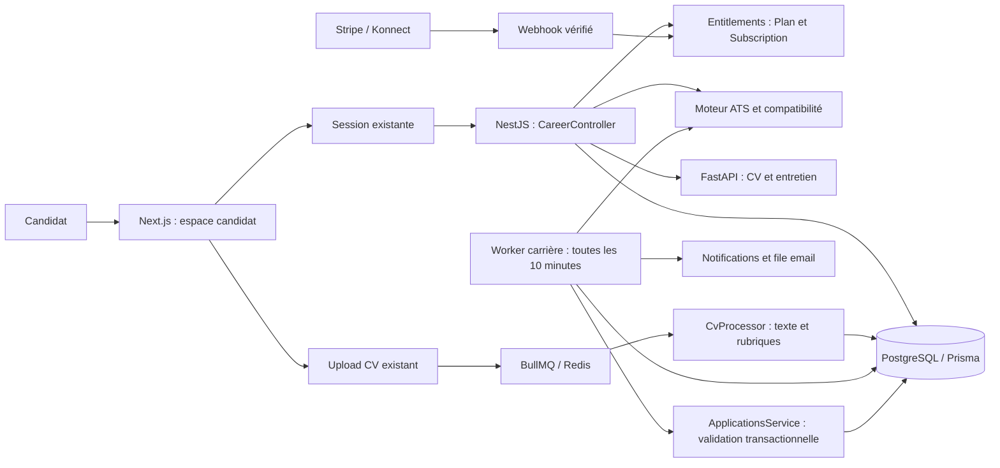
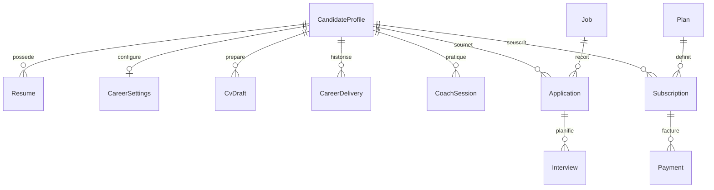
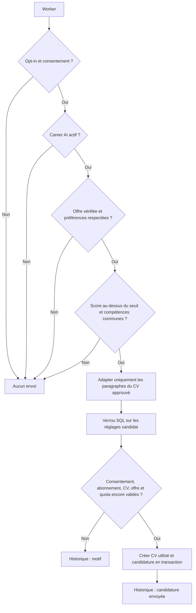

# EasyJob — Conception de l’espace candidat

État du code : 9 septembre 2026. Cette documentation décrit les fonctionnalités ajoutées et leur fonctionnement réel. Les migrations carrière ont été appliquées à la base locale. Voir EASYJOB_PRODUCT_CONCEPTION.md pour les évolutions suivantes et les limites actuelles.

## Parcours et fonctionnalités

| Espace | Fonctionnement | Accès |
|---|---|---|
| Tableau de bord | Score ATS du CV, progression du profil, état du CV, candidatures, invitations et recommandations | Free ; recommandations Pro |
| Trouver un emploi | Offres publiées, non expirées, d’entreprises actives et vérifiées ; recherche, domaine, lieu, compétences, contrat, niveau, mode de travail, salaire et tris | Free |
| Compatibilité sur les offres | Estimation calculée sur les données réelles ; aucun pourcentage si le profil ne fournit pas d’éléments exploitables | Free |
| Mes CV / ATS | Upload PDF texte, DOCX, TXT ou Markdown, jusqu’à 10 Mo ; extraction asynchrone, CV principal, versions, téléchargement et suppression | Free selon quota |
| Profil | Préremplissage initial des rubriques professionnelles ; consultation, import explicite et correction des informations extraites | Free |
| Rapport ATS | Critères, éléments détectés, informations manquantes, mots-clés de l’offre choisie et limites de l’analyse de texte | Free |
| Créateur de CV | Génération depuis le profil, optimisation, adaptation à une offre, versions ciblées, scores estimés avant/après | Pro |
| Validation du CV | Édition, aperçu professionnel, téléchargement Markdown, impression/enregistrement PDF, approbation explicite avant publication ou Auto Apply | Pro pour génération/publication |
| Recommandations | Strong / Good / Potential / Weak Match, éléments communs, compétences manquantes, exigences non vérifiées et détail des dimensions | Pro |
| Alertes | Activation volontaire, fréquences instantanée/quotidienne/hebdomadaire, domaines, lieux, modes de travail et seuil minimal | Pro |
| Auto Apply | Activation volontaire, consentement explicite, CV approuvé, seuil entier de 0 à 100 %, plafond journalier, exclusions et historique | Career AI |
| Coach d’entretien | Poste ou offre sélectionnée, entreprise, entretien technique/RH/comportemental/situationnel, questions et retour après chaque réponse | Career AI |
| Caméra et dictée | Caméra volontaire par session, cadrage et distance ; dictée si le navigateur la prend en charge, débit calculé sur sa durée | Career AI |
| Mes candidatures | Poste, entreprise, date, statut, scores réels, explication, CV utilisé, origine manuelle/automatique et entretiens | Free |
| Abonnement | Free, Pro, Career AI ; devis serveur selon le pays, achat, état du paiement et annulation | Tous |

La navigation reprend le logo, les couleurs, Inter, les thèmes et le sélecteur EN/FR/AR existants. Les nouveaux écrans disposent de traductions et respectent le sens RTL. Le menu est défilable et s’ouvre à droite en arabe sur mobile.

## Architecture



Les nouveaux endpoints utilisent les contrôles d’authentification existants. L’onboarding ouvre une vraie session par le mécanisme `establishSession` après inscription ; le raccourci de compte simulé a été retiré. Les données candidat sont toujours chargées à partir de l’utilisateur authentifié, puis les CV, brouillons et sessions sont filtrés par propriétaire.

## Données



- `CandidateProfile.professionalData` conserve les rubriques extraites ou corrigées : résumé, expérience, formation, compétences, langues, certifications, projets. L’import initial ne remplace pas un profil déjà corrigé.
- `Resume` conserve le texte extrait, l’état de traitement et le rapport ATS.
- `CvDraft` conserve le contenu original et édité, l’offre cible, les mots-clés, les scores avant/après et l’approbation. Une modification sans nouvelle approbation révoque cette dernière.
- `CareerSettings` conserve préférences, consentement, seuils, quota et référence du CV approuvé. Les alertes et Auto Apply sont désactivés par défaut.
- `CareerDelivery` évite les doublons candidat/offre/type et conserve les résultats d’envoi ou motifs d’échec.
- `CoachSession` conserve les questions, réponses et retours ; les images caméra ne sont pas conservées.
- `Application` conserve les scores, l’explication, l’origine automatique et un instantané du texte du CV utilisé.

Les références d’offre/CV dans les brouillons et l’historique sont des identifiants facultatifs ou historiques ; elles ne constituent pas toutes des clés étrangères SQL. Les relations obligatoires au candidat sont protégées par des clés étrangères.

## Calculs explicables

Le score ATS est une **estimation de lisibilité et de complétude du texte**, pas une certification d’un ATS commercial. Les critères totalisent 100 points : texte exploitable 20, email 10, téléphone 5, résumé 10, compétences 15, expérience 15, formation 15, longueur 5, éléments chiffrés détectables 5. Avec une offre cible, le score combine 80 % de ces critères et 20 % de couverture de ses compétences déclarées. Sans offre, aucune compétence « manquante » générique n’est inventée.

Le matching combine les compétences (40), l’expérience explicitement déclarée (15), la formation exigée (10), le domaine (5), la localisation (10), le niveau explicite (5) et les exigences textuelles (15). Les poids sont renormalisés sur les dimensions applicables. Les exigences absentes de l’offre ou non évaluables sont distinguées des exigences explicites sans preuve. La reconnaissance de compétences utilise des limites de mots, notamment pour distinguer React de Reactive et traiter C++ ou Node.js littéralement.

Classement : Strong ≥ 85, Good ≥ 70, Potential ≥ 45 — ou ≥ 30 avec compétences communes — puis Weak. Un profil sans données exploitables reste non analysé. Le moteur est déterministe ; les exigences complexes sont signalées comme non vérifiées lorsqu’il n’existe pas de preuve textuelle. Ce score mesure une couverture de preuves et ne prédit pas une embauche.

## Auto Apply



L’adaptation automatique réordonne des paragraphes déjà approuvés ; elle n’ajoute pas de qualifications inédites. Le quota journalier suit UTC. Un verrou Redis coordonne les workers ; sans Redis, aucun traitement sortant n’est lancé. La création relit les réglages sous verrou SQL, vérifie leur version et applique le plafond. La contrainte unique candidat/offre empêche une seconde candidature.

L’automatisation s’applique aux offres hébergées dans EasyJob. Aucune candidature sur un ATS ou site tiers n’est présentée comme envoyée. Le candidat peut désactiver les réglages après expiration ou diminution de son abonnement.

## IA et entretien

Avec un fournisseur de langage configuré, les prompts s’appuient sur le profil/CV et l’offre fournis. Les réponses restent modifiables avant usage. Sans fournisseur, le moteur déterministe conserve les informations du CV et le coach utilise une grille guidée, explicitement identifiée comme telle ; il ne simule pas une évaluation sémantique par un modèle.

La caméra analyse uniquement **le cadrage et la distance apparente** à partir d’une image temporaire avec OpenCV. Le regard, les gestes, la posture, les émotions, la nervosité, la confiance et le succès d’embauche ne sont pas déduits. La dictée est optionnelle et dépend du navigateur ; sa possible utilisation d’un service externe est indiquée dans l’interface. Le débit est calculé uniquement lorsqu’une durée de dictée est disponible.

L’extraction PDF nécessite du texte : les CV scannés sans couche texte ne sont pas convertis par OCR. Les sections non reconnues restent à compléter par le candidat. Les modèles de langage réels, la caméra physique et les paiements de passerelle nécessitent une validation dans leur environnement configuré.

## Paiements et plans

Les droits restent pilotés par `Plan.features`, jamais par le nom du plan dans les contrôles serveur. Career AI introduit `career.auto_apply`, `career.coach` et `career.vision`. Pro dispose de `career.builder`, `career.match` et `career.alerts`.

Le prix initial de Career AI est **19,99 USD/mois**, valeur de configuration modifiable. Les tarifs TND doivent être renseignés explicitement (`priceTndCents`) ; aucun taux de conversion n’est supposé. Les prix Stripe configurés doivent correspondre aux prix du plan. Un nouveau paiement crée une souscription en attente pour le plan choisi ; l’ancienne reste utilisable jusqu’au paiement confirmé. Un abonnement Stripe renouvelable doit être annulé avant un nouvel achat pour éviter deux renouvellements concurrents.

Les webhooks comparent le montant et la devise attendus et dédupliquent les événements dans la transaction. Les consultations de paiement vérifient leur propriétaire. Konnect est confirmé par une requête serveur au fournisseur ; une erreur réseau ne produit plus un faux paiement. Le mode de paiement de développement est refusé en production.

Références d’intégration vérifiées : [statut de paiement Konnect](https://docs.konnect.network/docs/en/api-integration/endpoints/get-payment-details), [callback GET Konnect](https://docs.konnect.network/docs/fr/api-integration/endpoints/webhook), [état de paiement Stripe Checkout](https://docs.stripe.com/api/checkout/sessions/object?lang=curl).

## Installation sans données fictives

Après démarrage de PostgreSQL et Redis, avec `DATABASE_URL` configurée vers la base voulue :

```powershell
npm run prisma:generate
npm run prisma:deploy
npm run prisma:seed:system
npm run build
```

`prisma:seed:system` initialise uniquement les rôles, permissions et plans. Il conserve les prix existants. Le seed de démonstration historique n’est pas nécessaire.

Lancer ensuite l’API, le worker et le frontend dans leurs terminaux habituels :

```powershell
# Racine, terminal API
npm run start:prod

# Racine, terminal worker
npm run start:worker

# Dossier web
npm run dev
```

FastAPI doit écouter sur `AI_SERVICE_URL`. Le secret `AI_API_KEY` doit être commun aux deux services. Configurer `AI_PROVIDER=openai` et les paramètres du fournisseur pour les fonctions génératives, ou `AI_PROVIDER=rule_based` pour les tests sans appels externes. Configurer SMTP pour la livraison réelle d’emails. Pour Konnect, fournir `KONNECT_WEBHOOK_URL` pointant vers l’API publique et son endpoint GET `/api/v1/payments/webhook/konnect`.

## Vérifications réalisées

- TypeScript serveur et frontend : réussi.
- Compilation NestJS et production Next.js : réussie ; les 47 pages statiques sont générées.
- Tests serveur : **118 réussis**, dont 33 nouveaux tests carrière/paiement.
- Tests frontend : **89 réussis**, dont 7 nouveaux tests carrière.
- Tests Python : **33 réussis** avec `AI_PROVIDER=rule_based`.
- Schéma Prisma : validé ; client généré.
- ESLint sur les fichiers carrière, facturation et intégration vérifiés : aucune erreur. Un avertissement React Compiler concerne le `form.watch` existant du formulaire d’offre. Les tests frontend existants émettent encore des avertissements jsdom/caméra et un avertissement React du parcours facial antérieur.

**Démarrage local vérifié le 9 septembre 2026 :** migration `20260909000100_candidate_career` appliquée sur PostgreSQL après sauvegarde dans `.runtime/easyjob-before-career-20260909.dump`. Le seed système a initialisé les rôles, permissions et plans, sans données de démonstration. Aucune base existante n’a été réinitialisée.

Le frontend répond sur `http://localhost:3001/login`, l’API sur `http://localhost:3000/api/v1/health` (PostgreSQL et Redis disponibles), et FastAPI sur `http://localhost:8000/health`. L’API et le worker tournent localement ; PostgreSQL, Redis et Mailpit tournent dans Docker. Mailpit reçoit le SMTP local sur `localhost:2525`, avec son interface sur `http://localhost:8026`. Mailpit reste disponible pour les tests. La configuration locale active utilise désormais Gmail SMTP sur le port 465 avec TLS et un mot de passe d’application stocké dans `.env` (ignoré par Git). L’authentification SMTP a été vérifiée ; une nouvelle demande de réinitialisation via l’API a été traitée par le worker et acceptée par Gmail le 9 septembre 2026. La réception dans la boîte du destinataire n’a pas été vérifiée. Les journaux et identifiants des processus sont dans `.runtime/`.

**Non exécuté : tests E2E avec PostgreSQL/Redis, validation visuelle par navigateur connecté, paiement réel, confirmation de réception dans la boîte email et fournisseur de langage réel.** Les contrôles HTTP de démarrage ne valident pas un parcours utilisateur complet.

Pour les E2E, utiliser une base PostgreSQL dédiée et une base Redis dédiée : le setup de test vide ses tables et nettoie ses files BullMQ. Ne pas utiliser la base et les files de l’application active.

Le matching est actuellement calculé sur les offres filtrées avant pagination. Pour un catalogue volumineux, prévoir l’indexation et le cache des scores ; cette version ne prétend pas valider la charge à grande échelle.
