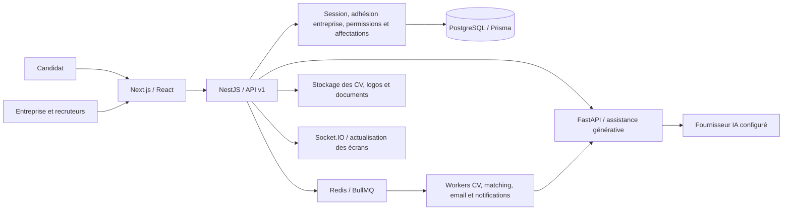
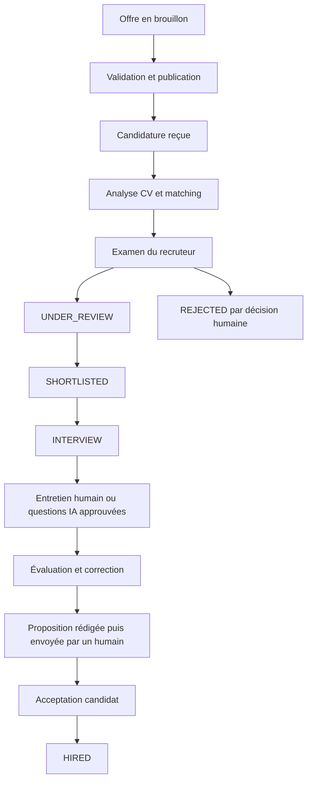
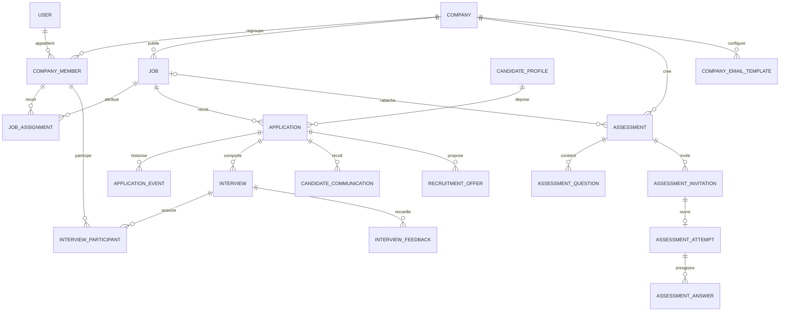

# EasyJob — Conception et état de l’espace entreprise

État du développement : 10 septembre 2026. Document établi à partir du code et des vérifications locales, pour le cahier des charges « Complete Company / HR / Recruiter Experience ».

L’espace entreprise couvre le parcours offre → candidature → examen humain → entretien → évaluation → proposition → embauche. Les données proviennent de l’API et de PostgreSQL. L’assistant IA propose du contenu ; ses suggestions nécessitent une intervention du recruteur. Cette version comporte encore les limites recensées à la fin de ce document : elle ne constitue pas une certification de préparation à la production.

## 1. Architecture réutilisée

Le projet possédait déjà l’authentification, la gestion des entreprises et des rôles, les offres, les candidatures, les CV, le matching, les entretiens, les notifications, les évaluations, les abonnements et un moteur d’automatisation. Leur profondeur fonctionnelle et leur intégration dans le parcours recruteur étaient inégales.

Les composants et services existants ont été étendus. Les nouvelles pages recruteur utilisent les composants visuels du projet, les sessions existantes et les contrôles de permission côté serveur.

Les tâches CV et matching utilisent les workers. Les nouvelles demandes d’assistance rédactionnelle et de rapport d’entretien appellent le service IA depuis NestJS. La clé du fournisseur reste côté serveur.

## 2. Parcours et écrans

| Espace | Route principale | Fonctionnement disponible |
|---|---|---|
| Inscription entreprise | `/company/register` | Coordonnées entreprise et responsable, mot de passe et confirmation, création du premier administrateur, logo, aucune vérification faciale imposée |
| Accueil guidé | `/company/:companyId/onboarding` | Informations entreprise, équipe, préférences, première offre ; enregistrement avant changement d’étape pour les formulaires de profil et préférences |
| Tableau de bord | `/company/:companyId/dashboard` | Offres et candidatures réelles, pipeline, catégories de compatibilité, activité, prochains entretiens, accès rapides |
| Offres | `/company/:companyId/jobs` | Liste, recherche, statut, création, édition, aperçu, duplication, soumission à validation, publication, pause, clôture et suppression autorisée |
| Détail d’offre | `/company/:companyId/jobs/:jobId` | Aperçu, exigences, équipe affectée, actions, statistiques propres à l’offre et assistance IA |
| Candidatures | `/company/:companyId/applications` | Vue globale et regroupement par offre ; listes et pipeline ; changement de statut enregistré |
| Candidatures d’une offre | `/company/:companyId/jobs/:jobId/applications` | Classement, filtres disponibles et pipeline de l’offre |
| Dossier candidat | `/company/:companyId/applications/:applicationId` | Profil, CV, expérience, formation, compétences, certifications, analyse, entretien, notes, événements, communications et propositions |
| Recherche candidats | `/company/:companyId/candidates` | Recherche dans les candidatures accessibles ; compétence, lieu, expérience, formation, langue, certification, mode de travail et catégorie de compatibilité |
| Entretiens | `/company/:companyId/interviews` | Liste et calendrier, filtres, création, participants, statut, retour structuré et entretien IA |
| Évaluations | `/company/:companyId/assessments` | Création de questions, rattachement facultatif à une offre, invitation, résultats et correction humaine |
| Équipe | `/company/:companyId/team` | Membres actifs, rôles, invitations, protection du propriétaire et du dernier administrateur |
| Notifications | `/company/:companyId/notifications` | Notifications filtrées par entreprise, lecture, suppression et navigation |
| Facturation | `/company/:companyId/billing` | Formule, consommation réelle, historique de paiement, factures disponibles, changement de formule selon fournisseur et résiliation |
| Paramètres | `/company/:companyId/settings` | Profil et logo, culture, avantages, préférences, seuils, modèles de messages, vérification documentaire et audit |
| Profil public | `/companies/:slug` | Présentation de l’entreprise, logo, culture, avantages et offres publiées |
| Entretien IA candidat | `/recruitment-interviews/:id` | Questions approuvées par le recruteur, réponses du candidat authentifié, soumission unique |
| Proposition candidat | `/recruitment-offers/:id` | Lecture d’une proposition envoyée et réponse d’acceptation ou de refus |
| Évaluation candidat | `/assessments/attempt/:token` | Accès par invitation appartenant au candidat, questions sans corrigé, réponses et soumission |

La recherche dans la barre de navigation regroupe les offres, candidats, candidatures, entretiens et membres accessibles. Le changement d’entreprise annule les requêtes et recharge le contexte pour éviter l’affichage de données de l’entreprise précédente.

## 3. Cycle métier

`UNDER_REVIEW` est distinct de `SHORTLISTED`. Les transitions enregistrent l’acteur, la date et la source. Une proposition en brouillon reste privée. Son envoi place la candidature au stade `OFFER` ; son acceptation ne produit `HIRED` que si la candidature est toujours à ce stade.

Les communications sont rédigées ou reprises d’un modèle, puis envoyées explicitement par le recruteur. Le même identifiant de requête évite une nouvelle mise en file lors d’une répétition. L’historique indique la mise en file ; il ne prétend pas prouver la réception dans la boîte mail.

Les invitations d’évaluation contiennent un lien utilisable. Le serveur vérifie le propriétaire de l’invitation et son expiration. Les réponses répétées ou inconnues sont rejetées avant toute écriture. La soumission et le score sont enregistrés dans une transaction. Les questions ouvertes restent sans note jusqu’à la correction humaine ; une note ne peut pas dépasser les points de la question. La correction est auditée et ne modifie pas le statut de recrutement.

## 4. Conception des données

### Migrations ajoutées pendant ce travail

| Migration | Changements |
|---|---|
| `20260909000500_company_workspace` | Profil entreprise enrichi, préférences et onboarding ; propriétés d’offres ; affectations ; participants et retours d’entretien ; modèles, communications et propositions |
| `20260909000600_recruitment_stages` | Étape `UNDER_REVIEW`, état de publication `PAUSED` et compléments du cycle de recrutement |
| `20260909000700_assessment_jobs` | `Assessment.jobId` facultatif, index et clé étrangère ; suppression d’une offre détache l’évaluation sans la supprimer |

Les noms et colonnes exacts sont définis dans `prisma/schema.prisma` et les scripts SQL des migrations. Les migrations ont été appliquées à la base locale après sauvegarde et à la base de tests isolée. Aucune réinitialisation de la base de l’application n’a été effectuée.

## 5. Permissions et isolation

| Rôle | Portée et droits principaux |
|---|---|
| Administrateur entreprise | Gestion de l’entreprise, membres, offres, candidatures, entretiens, évaluations, facturation et paramètres |
| RH | Offres, dossiers, transitions, entretiens, statistiques et invitations d’équipe ; pas les paramètres administrateur ni les évaluations avec la matrice actuelle |
| Recruteur | Offres, dossiers, transitions, entretiens et statistiques ; pas l’administration de l’entreprise |
| Responsable de recrutement | Candidatures et statistiques des offres auxquelles il est affecté |
| Intervieweur | Entretiens auxquels il participe et dossiers associés ; pas les autres entretiens du même poste ; création d’entretien refusée par le service |
| Candidat | Ses candidatures, invitations, réponses et propositions envoyées ; pas les notes internes ni les rapports privés du recruteur |

Les permissions sont vérifiées côté API, indépendamment de la visibilité des boutons. Les restrictions d’affectation s’appliquent aux requêtes de listes, dossiers, statistiques et CV. Les utilisateurs aux rôles restreints ne rejoignent pas la salle Socket.IO globale de l’entreprise. L’actualisation périodique et les notifications personnelles complètent leurs mises à jour.

Les données publiques de l’entreprise excluent les informations privées d’immatriculation, les coordonnées privées et les membres. Le logo est limité en taille et son contenu doit correspondre à PNG, JPEG ou WebP. Une entreprise suspendue ne peut plus effectuer les écritures contrôlées par les permissions du service d’accès.

## 6. API ajoutée ou étendue

Préfixe commun : `/api/v1`.

| Groupe | Endpoints / responsabilités |
|---|---|
| Workspace | `GET companies/:id/workspace/overview`, `candidates`, `interviews`, `search`, `billing`, `audit` |
| Préférences | `GET/PATCH companies/:id/workspace/settings` |
| Affectations | `GET/PATCH companies/:id/workspace/jobs/:jobId/assignments` |
| Communications | `GET/POST companies/:id/workspace/applications/:applicationId/messages` |
| Modèles | `GET/POST companies/:id/workspace/templates` |
| Retour entretien | `POST companies/:id/workspace/interviews/:interviewId/feedback` |
| IA | Assistance rédactionnelle, publication de questions relues, réception des réponses et génération de rapport via les contrôleurs Recruitment AI |
| Propositions | Brouillon, liste par candidature, envoi, consultation propriétaire et réponse via les contrôleurs Recruitment Offers |
| Entreprise | Profil privé protégé, profil public par slug et chargement de logo |
| Évaluations | `POST companies/:id/assessment-attempts/:attemptId/grade` ; DTO imbriqués validés ; création et modification avec `jobId` |
| Existants renforcés | Listes et dossiers de candidatures, CV, entretiens, statistiques et notifications filtrés par entreprise et affectation |

Les services existants conservent leurs endpoints pour les offres, les sessions, les membres, les paiements et les candidatures. Les nouveaux services ne remplacent pas l’authentification du projet.

## 7. Intelligence artificielle

- Matching existant enrichi dans l’interface : score, justification, exigences manquantes et comparaison avec l’offre.
- Catégories configurables : excellent ≥ 90, fort ≥ 80, bon ≥ 70, potentiel ≥ 55, faible en dessous ; absence de score = non analysé. Les seuils doivent être strictement décroissants.
- Assistance pour description d’offre, compétences, critères, questions, messages, évaluations et observations sur les statistiques.
- Les observations du tableau de bord utilisent les candidatures accessibles des 30 derniers jours et un échantillon explicite des exigences manquantes.
- Questions d’entretien éditables et approuvées avant accès candidat.
- Rapport fondé sur les réponses textuelles : contenu, points forts, lacunes, relances et notes techniques, clarté, résolution de problèmes et connaissance du poste quand les preuves suffisent.
- Aucune décision automatique d’embauche ou de rejet dans ce parcours ; pas d’inférence à partir du visage, des émotions ou des caractéristiques protégées.
- Une erreur du fournisseur n’est pas remplacée par une réponse IA fictive. Les demandes échouées sont identifiées comme indisponibles.

**Constat externe :** le dernier appel réel de l’assistance générative a reçu HTTP 429 du fournisseur. Le motif précis, quota ou limitation temporaire, n’a pas été confirmé. Le service traite maintenant cette situation comme une indisponibilité contrôlée ; les tests de ce comportement utilisent un fournisseur simulé. La génération réelle reste à revérifier lorsque le fournisseur acceptera les demandes.

## 8. Automatisation, interface et exploitation

Les candidatures alimentent le processus d’analyse existant. Les actions explicites des recruteurs produisent les notifications métier prévues par les services. Un service de rappels recherche toutes les dix minutes les entretiens des prochaines 24 heures, déduplique les notifications et remet les rappels à disposition après replanification. L’acceptation d’une proposition préalablement envoyée par le recruteur produit l’embauche.

L’interface utilise des cartes et tableaux sobres, le thème clair/sombre existant, des états de chargement et d’erreur, des listes paginées et les traductions anglais/français/arabe avec direction RTL. Les nouvelles fonctions ne reposent pas sur des compteurs de démonstration. L’ancien panneau d’automatisations n’est pas ajouté à la navigation principale.

La panne locale Docker liée à `sailor-ingest.sock` a été contournée en conservant l’ancien dossier d’exécution sous un autre nom, puis en relançant Docker Desktop. Les volumes PostgreSQL n’ont pas été supprimés. L’application utilise les processus API, worker, service IA et frontend ; leurs journaux locaux sont dans `.runtime`.

## 9. Vérifications effectuées

| Vérification | Résultat constaté |
|---|---|
| Backend, tests unitaires | 19 suites, 148 tests passés lors de la validation du workspace |
| Backend, parcours intégrés final | 2 suites, 16 tests passés, dont inscription de fixtures, portée des rôles, pipeline, entretiens, communications, proposition acceptée et évaluation corrigée |
| Service Python IA | 39 tests passés, dont refus de résultats invalides et traitement d’un HTTP 429 sans exposer les détails du fournisseur |
| Frontend | 12 fichiers, 96 tests passés, dont la correction humaine ; tous passés sur le dernier lancement séquentiel |
| TypeScript et compilation | Compilations de production NestJS et Next.js réussies ; TypeScript validé ; API, service IA et inscription web répondent HTTP 200 après redémarrage |
| Migrations | 11 migrations reconnues ; schéma local à jour, vérifié après application |
| Navigateur | Inscription entreprise contrôlée en anglais, français et arabe ; RTL correct et absence de débordement horizontal dans la fenêtre contrôlée |
| Données de test | Base `easyjob_product_test_*` et Redis sur 6399 ; fournisseur email console ; aucune invitation ni proposition de test envoyée à une personne réelle |

Les avertissements jsdom sur caméra/canvas concernent les simulations des tests biométriques. Python signale un accès refusé à son cache pytest ; les tests eux-mêmes passent. Le premier lancement de tests frontend avait rencontré un délai de démarrage de worker ; le dernier lancement intégral est passé.

## 10. Limites restantes et critères avant mise en production

1. **IA externe** : résoudre ou attendre la disparition de l’erreur 429, puis refaire un essai réel. Les rapports sont générés à la demande du recruteur ; pas de notation vidéo/audio ni d’analyse automatique de chaque réponse individuelle.
2. **Viviers et recherche** : la recherche workspace couvre les candidats ayant postulé aux offres accessibles. Elle ne constitue pas un moteur de sourcing universel des profils publics. Les filtres langue/certification correspondent aux valeurs exactes sauvegardées ; la disponibilité et certains filtres avancés par offre restent à compléter.
3. **Calendriers externes** : calendrier interne disponible ; aucune synchronisation Google Calendar/Outlook ni lien de visioconférence automatiquement créé par un fournisseur connecté.
4. **Propositions** : brouillon, envoi et réponse sont disponibles ; édition, retrait et versionnement avancé des propositions ne sont pas encore livrés. La reprise d’une notification après une panne entre la transaction métier et l’envoi doit être renforcée par une boîte d’envoi transactionnelle.
5. **Historique** : transitions, notes, communications et journaux disponibles ; tous les événements d’entretien et d’évaluation ne sont pas encore réunis dans une chronologie métier unique.
6. **Facturation** : les données affichées sont réelles, mais un paiement réel requiert un fournisseur et les webhooks correctement configurés. Aucun achat ni test de débit réel n’a été effectué.
7. **Traductions** : les nouveaux écrans principaux et la correction d’évaluations sont traduits. Certains libellés des pages historiques, notifications enregistrées côté serveur et codes du journal d’audit restent à harmoniser ; une revue linguistique complète de l’arabe tunisien reste nécessaire.
8. **Performance** : tableaux paginés ; une colonne du kanban ne représente que la page chargée, comme indiqué dans l’interface. Certains calculs statistiques chargent les candidatures de la période en mémoire ; les agrégations SQL et essais de charge restent à réaliser pour de gros volumes.
9. **Couverture visuelle** : l’inscription publique a été vérifiée au navigateur. Les parcours privés ont été vérifiés par tests, mais pas par une campagne visuelle authentifiée exhaustive sur tous les écrans et appareils. L’aperçu d’offre n’utilise pas encore un rendu intégralement commun avec chaque vue candidat historique.
10. **Évaluations** : rattachement, invitation, réponses, scores et correction disponibles. Le chronomètre n’est pas un dispositif de surveillance ; l’expiration de l’invitation est contrôlée, mais la durée affichée n’est pas une limite d’examen strictement imposée côté serveur. Les historiques de versions des questions et le sourcing paginé du sélecteur de candidats restent à approfondir.

Ces limites sont des travaux identifiés, pas des fonctionnalités simulées. Le code disponible permet de parcourir le cycle de recrutement principal ; les points ci-dessus doivent rester visibles dans la recette du produit.

