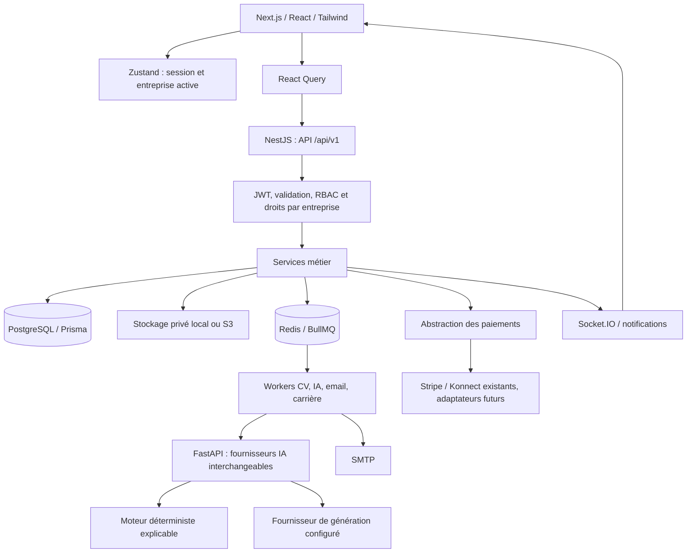
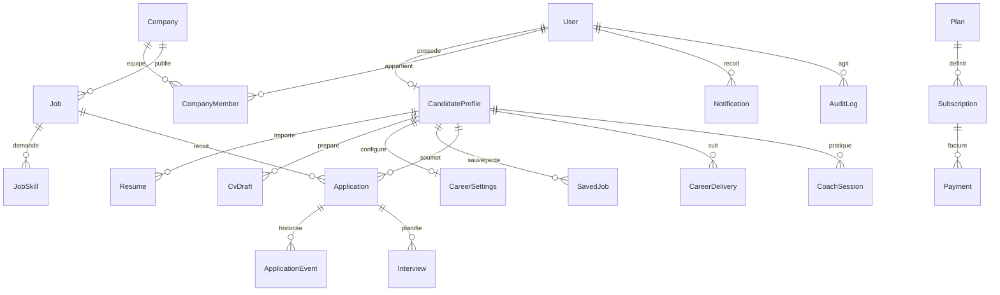

# EasyJob — Conception produit et état de l’implémentation

Ce document décrit le code local après l’évolution du parcours candidat et de l’espace recrutement. Il complète l’analyse initiale, qui décrivait un état antérieur du projet. Les fonctions présentes, les intégrations configurables et les limites de validation sont distinguées ci-dessous.

## 1. Parcours central

Le candidat conserve la maîtrise de ses informations et des candidatures envoyées. Une estimation de compatibilité sert à comprendre les exigences d’une offre ; elle ne garantit ni entretien ni embauche.

## 2. Espaces et fonctionnalités

| Espace | Fonctions présentes |
|---|---|
| Public | Accueil centré sur le parcours professionnel, recherche par poste et lieu, explication des outils, sections candidats/entreprises, tarifs issus du serveur, FAQ et pages d’information. |
| Connexion | Email/mot de passe, vérification email, récupération du mot de passe, restauration de session, déconnexion, authentification faciale existante. L’ancien bouton Google sans intégration a été retiré de la connexion. |
| Accueil candidat | Parcours guidé en neuf étapes : bienvenue, informations personnelles, upload, traitement, relecture/import du profil, ATS, préférences, recommandations selon abonnement, choix de formule. Possibilité de compléter le CV plus tard. |
| Tableau de bord candidat | Salutation, complétude du profil, CV et score ATS disponibles, candidatures, favoris, invitations, prochain entretien, état Auto Apply, accès au coaching et recommandations. |
| Recherche candidat | Poste/mot-clé, domaine, compétences, lieu, entreprise, date de publication, télétravail/hybride/présentiel, temps plein/partiel/stage/freelance/contrat, CDI/CDD, expérience et fourchette de salaire. Pagination et tris. |
| Favoris | Sauvegarde/retrait, vues enregistrées/postulées/expirées, accès aux recommandations ; les données restent propres au candidat. |
| CV et profil | Upload, traitement asynchrone, versions, CV principal, téléchargement protégé, suppression, rubriques professionnelles extraites et éditables. |
| ATS | Estimation explicable : critères, points forts, éléments manquants, mots-clés de l’offre choisie, suggestions et limites. Aucun score inventé quand le texte est absent. |
| Créateur de CV | Génération depuis le profil, optimisation, adaptation à une offre, édition, versions, amélioration d’une section, validation explicite, scores avant/après calculés, aperçu classique/moderne/compact, Markdown et impression PDF. |
| Matching | Couverture documentée des compétences et exigences, expérience, lieu et autres dimensions disponibles. Catégories Strong/Good/Potential/Weak, détails accessibles selon abonnement. |
| Alertes | Activation volontaire, critères communs de recherche, seuil, fréquence, notifications internes et email via file de tâches. |
| Auto Apply | Consentement, activation/désactivation, CV approuvé, seuil entier 0–100, limite quotidienne, domaines, lieux, modes de travail, contrats, salaire/devise, entreprises et offres exclues. Statistiques et historique réels. |
| Coach | Questions RH, techniques, comportementales et situationnelles liées au poste ; réponses successives, retour écrit, dictée selon navigateur, débit mesuré lorsque la durée est disponible. |
| Caméra de coaching | Consentement par session, activation/arrêt, analyse d’images en mémoire pour cadrage et distance. Les données ne sont pas transmises au recruteur. |
| Suivi candidat | Offre, entreprise, date, statut, CV utilisé, origine manuelle/automatique, scores et explication disponibles, entretiens et historique public de progression. |
| Tableau de bord RH | Espace d’entreprise séparé, compteurs liés aux données métier, navigation offres/candidatures/entretiens/équipe/analytique/évaluations/facturation/paramètres. |
| Gestion des offres | Création, édition, soumission, approbation administrative, publication, pause, fermeture et duplication en brouillon. Domaine, compétences, expérience, mode de travail, contrat, salaire, langues et formation. |
| Candidatures RH | Première vue par offre avec nombre de candidatures, nouvelles, présélectionnées et bonnes compatibilités ; recherche, filtres et tri à l’intérieur de l’offre sélectionnée. |
| Pipeline RH | Colonnes de statuts, déplacement par glisser-déposer et sélection accessible, règles de transition, notifications et historique. Les compteurs de colonnes indiquent la page chargée. |
| Analyse RH | Score disponible, éléments communs/manquants, explication et classement par offre. Les candidatures non analysées ne reçoivent pas de score ni de rang fictif. |
| Collaboration | Équipe et rôles, invitations, notes internes, entretiens, évaluations et notifications existants. Les notes et métadonnées privées ne sont pas accessibles au candidat. |
| Abonnements | Plans et droits configurés côté serveur, devis, commandes/paiements, confirmation par webhook, historique et annulation. Aucun succès de paiement simulé hors tests. |
| Administration | Utilisateurs, entreprises, vérifications documentaires, modération des offres, abonnements, statistiques et audit existants. |

## 3. Architecture réutilisée

Les modules existants `auth`, `companies`, `company-members`, `jobs`, `applications`, `candidates`, `interviews`, `assessments`, `notifications`, `subscriptions`, `payments`, `files`, `audit` et `admin` sont conservés. Le module `career` relie ces fonctions au parcours candidat. Le moteur `career-engine` sépare les calculs explicables de la génération de texte ; FastAPI sépare parsing, CV, matching, questions, retours et vision.

## 4. Modèle de données

Les noms exacts et les relations exhaustives restent définis dans `prisma/schema.prisma`. Plusieurs concepts demandés sont regroupés : `Resume` porte le texte et le rapport ATS ; `Application` conserve les scores et explications de screening ; `ApplicationEvent` conserve l’historique ; `CareerDelivery` suit les alertes et exécutions Auto Apply ; `CoachSession` contient questions, réponses et retours. Les factures du fournisseur sont représentées par les références et liens de paiement, sans système autonome de facturation fiscale.

Migrations ajoutées :

- `20260909000100_candidate_career` : socle carrière, CV, coaching et ajustements de paiement.
- `20260909000200_career_preferences` : contrats souhaités, salaire/devise et exclusions d’offres.
- `20260909000300_payment_schema_alignment` : champs/index de paiement manquants sur une installation propre ; conservation des paiements existants.
- `20260909000400_job_contracts_languages` : CDI/CDD et langues des offres, préférences correspondantes.

Ces migrations ont été appliquées à la base locale de l’application. Une sauvegarde préalable est conservée dans `.runtime`.

## 5. Règles sensibles

### Auto Apply

Le worker vérifie la formule, l’email confirmé, le consentement, le CV approuvé, les critères, l’absence de candidature existante et le plafond quotidien. Les conditions sont vérifiées à nouveau dans la transaction de candidature, avec version des paramètres et verrouillage. La clé unique offre/candidat évite les doublons.

Le salaire doit être annoncé dans la devise choisie. Aucune conversion monétaire implicite n’est effectuée. Les statistiques utilisent les candidatures réellement enregistrées et les traitements réellement effectués. La journée du quota est calculée en UTC et indiquée à l’écran.

Le périmètre d’envoi couvre les offres gérées par EasyJob. Aucun robot de candidature sur des sites externes non intégrés n’est annoncé comme opérationnel.

### Décisions RH

Le screening fournit de l’information. Les transitions finales rejet/offre/embauche ne peuvent pas être exécutées par les règles automatiques sur la seule base d’un score. Le recruteur autorisé prend la décision ; les modifications sont historisées. Une mise à jour concurrente du statut est détectée.

### Sessions et confidentialité

Le changement de compte purge le cache privé, l’entreprise active et la socket précédente. Une révision de session empêche une réponse tardive de connexion, de rafraîchissement ou d’API de réinstaller les données d’un autre compte. Les préférences de langue et de thème sont conservées séparément.

Lors d’un rechargement d’une page privée, la restauration conserve l’état « chargement » jusqu’à la validation de l’identité par `/auth/me`. Elle ne publie pas temporairement l’état « déconnecté », qui provoquerait une redirection prématurée vers la connexion. Un test de régression vérifie les états observés pendant cette transition.

Les notes RH restent privées. Un candidat ne peut lire ni les notes ni leurs copies dans les métadonnées d’événements. Les CV restent soumis à l’autorisation du propriétaire ou d’un recruteur ayant une candidature liée.

### Paiements

La formule ne change qu’après confirmation vérifiée côté serveur. Le montant et la devise doivent correspondre au paiement attendu. Les webhooks sont dédupliqués ; un renouvellement distinct ne remplace pas le paiement initial. Un renouvellement échoué reçoit son propre état et sa notification.

Le fournisseur de simulation est limité à `NODE_ENV=test`. Dans la configuration locale actuelle, le paiement en ligne est indisponible tant qu’un fournisseur réel n’est pas configuré. L’abstraction permet un futur adaptateur Flouci ; aucun adaptateur Flouci opérationnel n’est revendiqué.

## 6. Limites et préparation de la production

- **IA générative** : un fournisseur peut être configuré par variables d’environnement. Les tests automatiques utilisent des réponses déterministes ; ils ne prouvent pas la disponibilité, le quota ou la qualité d’un fournisseur externe en production.
- **ATS** : estimation basée sur le texte et les exigences fournies, sans garantie de reproduire tous les ATS du marché. Les documents scannés sans texte demandent un OCR non fourni par ce parcours.
- **Caméra** : cadrage et distance uniquement. Pas d’inférence d’émotions, de personnalité, de confiance, de caractéristiques protégées ou d’employabilité. Le produit n’affiche pas de faux scores de regard, posture ou expression.
- **PDF** : export via l’impression du navigateur. L’utilisateur choisit « Enregistrer au format PDF ». Il n’existe pas encore de service de rendu PDF dédié.
- **Internationalisation** : les nouveaux parcours et la connexion utilisent EN/FR/AR avec RTL et persistance corrigée. Certains écrans historiques d’administration, de facturation et de gestion détaillée conservent des textes anglais ; leur traduction exhaustive reste à terminer.
- **Performance** : les listes affichées sont paginées. Le classement de recommandations parcourt les offres filtrées ; une matérialisation des correspondances et des tests de charge restent nécessaires pour un très grand catalogue.
- **Mise en production** : domaine, HTTPS, stockage distant, fournisseur de paiement, emails transactionnels, supervision, sauvegardes/restauration et tests de charge doivent être validés sur l’environnement cible. Le build local ne constitue pas une certification de disponibilité en production.

## 7. Vérification

Les rapports de la dernière exécution se trouvent dans `.runtime/product-*-results.log`, `.runtime/product-web-tests.log`, `.runtime/product-python-tests.log`, `.runtime/product-*-build.log` et `.runtime/product-*-lint.*`. Les tests d’intégration utilisent exclusivement une base et un Redis dédiés, avec emails capturés et paiements de test. Ils ne créent pas de faux candidats dans la base utilisée par l’interface.

Couverture critique : changement de compte et réponses tardives, consentement Auto Apply, critères/exclusions, propriété des CV, notes privées, isolation d’entreprise, transitions humaines, quotas, signatures de paiement, montants, déduplication et renouvellements échoués. Le navigateur sert à vérifier le rendu réel, le RTL, la persistance et les états vides/erreurs.

### Résultats locaux du 9 septembre 2026

- Backend : build réussi ; 130 tests unitaires réussis dans 18 suites.
- Interface : build de production réussi (63 pages) ; 94 tests validés dans 11 fichiers, dont le nouveau test de restauration de session. La dernière exécution générale a donné 90 succès et 4 dépassements du délai de cinq secondes pendant la compilation simultanée ; la suite de connexion a ensuite été rejouée seule avec 6 succès sur 6 (`product-login-final-results.log`). Lint sans erreur, avec 51 avertissements restant à traiter ; les fichiers de session modifiés ont également passé un contrôle ciblé.
- Service Python : 34 tests réussis avec le fournisseur déterministe `rule_based`. La santé du service indique le fournisseur sélectionné et précise que sa connectivité externe n’a pas été vérifiée.
- Intégration : 16 tests d’authentification et 9 tests de facturation réussis ; 19 tests de recrutement et de sécurité réussis après correction du ciblage du destinataire dans le helper de vérification d’email. Ces résultats proviennent de plusieurs exécutions, et non d’un seul rapport entièrement vert.
- Contrôle complémentaire : les 12 tests de sécurité ont été rejoués avec succès après correction du test de fermeture d’offre pour appeler le véritable endpoint `POST /jobs/:id/close` et exiger un refus `403` entre entreprises.
- Navigateur : accueil et tarifs chargés depuis l’API ; tableau de bord du compte existant accessible ; langue arabe conservée après rechargement ; formulaire mobile de 390 pixels sans débordement horizontal ; préférence EN et taille de navigateur restaurées après vérification.
- Disponibilité locale : interface sur `http://localhost:3001`, API sur le port 3000, service IA sur le port 8000 ; contrôles HTTP de santé réussis. L’interface utilise le serveur de production standalone de Next.js, avec les ressources `public` et `.next/static` copiées dans sa sortie.

Le mot de passe prérempli dans le formulaire de connexion a été refusé ; l’accès au tableau de bord a ensuite été vérifié grâce à la session existante restaurée. Aucun mot de passe du compte n’a été modifié pendant ces contrôles.
